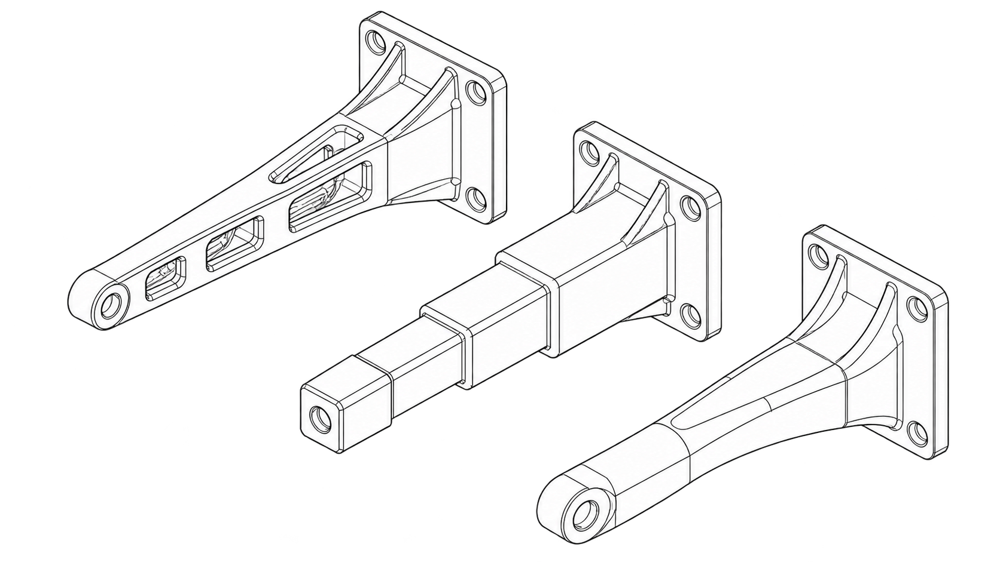
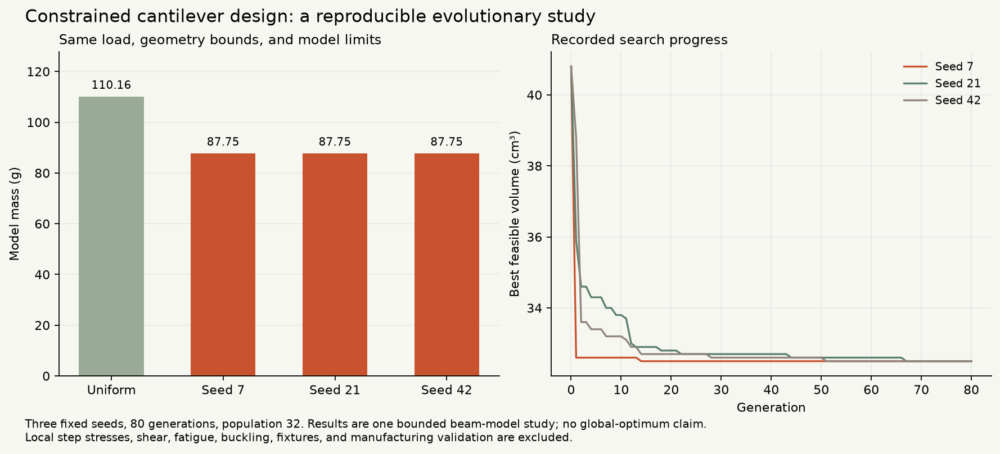

# Generative Design & Manufacturing



*Generated line-art concept illustration.*

**FORM** is a reproducible geometry-search study. It generates stepped beam profiles, checks an explicit mechanics model, compares them with a stated baseline, and exports the evaluated geometry.



This implementation uses **seeded evolutionary search**. It does not train or call a neural model. The results are a bounded design experiment, with physical and manufacturing validation still pending.

## Explore the designs

Requires Python **3.11 or newer**. No third-party runtime dependencies, model download, or paid key is needed.

```sh
python3 scripts/serve.py
```

Open **http://127.0.0.1:8790/**. Select a seed and recorded generation, inspect the actual profile against the uniform baseline, read constraint margins, and download the final SVG, DXF, or OpenSCAD source. Browser controls inspect recorded runs; the command below generates new ones.

## Generate and reproduce

```sh
python3 -m design_lab generate --out study-run
python3 scripts/reproduce.py
```

The output directory must be new. It contains a JSON report and baseline/final geometry exports. Reproduction checks the committed default report and every export byte-for-byte, without network access.

For another study, supply a partial JSON configuration with `--config file.json`, or select seeds and search limits:

```sh
python3 -m design_lab generate --out /tmp/my-beam-study --seeds 4 12 --generations 60 --population 24
```

The [contract](docs/contract.md) lists configuration fields, units, bounds, output schemas, and error codes.

## Measured default result

The default study uses a **240 mm span**, **10 mm width**, **50 N tip load**, and 12 symmetric height sections. The illustrative modulus is 69,000 MPa and density is 0.0027 g/mm³. Height bounds, grid, neighbouring steps, nominal stress, and tip deflection are constrained.

| Design | Volume (mm³) | Model mass (g) | Tip deflection (mm) | Maximum nominal stress (MPa) |
| --- | ---: | ---: | ---: | ---: |
| Smallest feasible uniform height, 17 mm | 40,800 | 110.16 | 0.8156 | 24.9135 |
| Seed 7 | 32,500 | 87.75 | 0.9991 | 20.7612 |
| Seed 21 | 32,500 | 87.75 | 0.9975 | 21.0373 |
| Seed 42 | 32,500 | 87.75 | 0.9980 | 21.3333 |

All three final profiles pass the **25 MPa nominal stress** and **1 mm tip-deflection** limits in this model. Each reduces volume by **20.343%** against the same uniform baseline. The shapes differ despite equal final volume. These three seeds do not establish a global optimum or general performance.

The study used **7,776 candidate-profile evaluations**, including repeats. This count excludes uniform-baseline grid scans and export verification. See [methods and results](docs/methods.md) and the complete [measured report](web/assets/report.json).

## Verify and build

Node.js **22 or newer** is needed only for JavaScript checks.

```sh
python3 -m unittest discover -s tests -v
node --test tests/viewer.test.mjs
python3 scripts/reproduce.py
python3 scripts/build.py
```

The static bundle is in `dist/`. Public deployment is separate from this local build. Optional plotting and independent DXF checks use `requirements-figures.txt` and `requirements-verification.txt`; see the [verification record](docs/verification.md).

## Model boundary

The evaluator integrates a piecewise Euler–Bernoulli cantilever with a common neutral axis. It is checked against closed-form uniform beams, load/modulus scaling, and independent numerical quadrature. The geometric rules are a study constraint set, not a complete manufacturing process plan.

Step/clamp stress concentrations, shear deformation, fatigue, buckling, fixtures, local loading, material certification, tolerances, and process validation are excluded. No FEA or physical test is claimed. OpenSCAD source export is provided; an OpenSCAD engine has not been run. Do not treat these files as fabrication-ready structural designs.

## History and sources

This repository became the design study on **27 October 2026**. The original plotter work is preserved on [`archive/before-generative-design-2026-10-27`](https://github.com/ungaaaabungaaa/generative-design-manufacturing/tree/archive/before-generative-design-2026-10-27). Its earlier history and stars predate this implementation. The portfolio website remains unchanged.

[MIT beam-deflection reference](https://web.mit.edu/1.105/emech10_04.pdf), [attribution](THIRD_PARTY_NOTICES.md), [contributing](CONTRIBUTING.md), [security notes](SECURITY.md). MIT applies to the new code; see [LICENSE](LICENSE).

## Check sensitivity to tip load

```sh
python3 scripts/load_sensitivity.py --loads 40 50 60 --out load-sensitivity.json
```

This re-evaluates the bundled uniform baseline and each final seeded design at explicit loads in newtons. It preserves their geometry and records actual stress, deflection, margins, feasibility, and violations using the same evaluator. Failed loads remain in the output. The JSON includes the source report hash and model configuration. Supply 1–16 unique loads within 1–5000 N; existing files are never overwritten. This is a model-only sensitivity check, without re-optimization or physical certification. The nominal search and committed study results are unchanged.

## Validate SVG export round trips

```sh
python3 scripts/check_svg_roundtrip.py --bundle web/assets --out svg-roundtrip.json
```

Use any bundle generated by this project. The command independently parses each bounded plain SVG with the standard XML parser and checks millimetre dimensions, viewBox, closure, all profile coordinates, and polygon area/volume against its evaluated report geometry. It records measured values, source-report hash, and each SVG hash in a new JSON file. Unsupported transforms, active/complex XML, wrong units, changed geometry, symlinks, oversized inputs, and existing outputs are rejected. This supports the project's simple profile format; it does not establish CAD application compatibility, fabrication, or physical certification.
